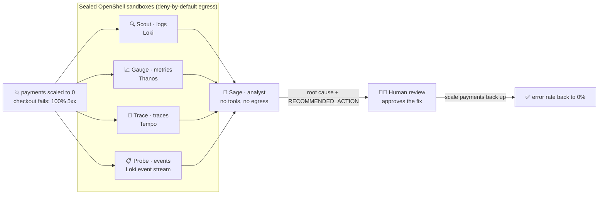
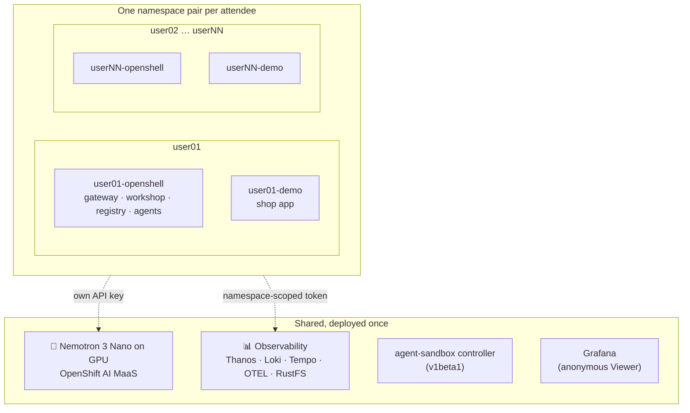
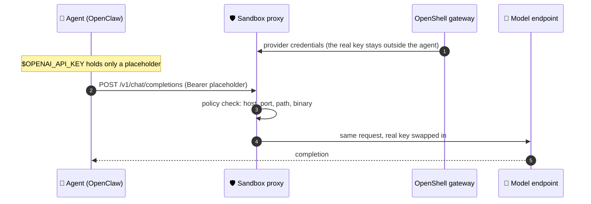

<div align="center">

# AIOps on OpenShift

### A fleet of sandboxed AI agents that investigates a real incident, and a hands-on lab to build it yourself

[](https://github.com/rh-ai-quickstart/aiops-sandboxed-agent-fleet/actions/workflows/ci.yml)
[](LICENSE)


**[Quick start](#-quick-start)** · **[Hands-on lab](#-run-it-as-a-hands-on-lab)** · **[Admin guide](docs/ADMIN-GUIDE.md)** · **[Attendee guide](docs/USER-GUIDE.md)** · **[Review report](README-DEPLOYMENT-REVIEW.md)**

</div>

---

A real dependency of a shop application goes down on Red Hat OpenShift. Four specialist AI agents, each **sealed in its own OpenShell sandbox** and allowed to reach **exactly one** observability backend, investigate in parallel. An analyst agent with no tools and no network combines their findings into a root cause and a fix, and a human approves it.

The repository ships the whole stack and an **interactive workshop** (30 lessons, live in-browser terminal) that teaches you to build it, from a single sandbox to the full SRE fleet.

Built by Anshul Jindal and Max Murakami.

## ✨ Highlights

<table>
<tr>
<td width="33%" valign="top">

**🔒 Sealed agents**<br/>
Deny-by-default L4 + L7 policies per agent, `restricted-v2` (no privileged SCC). Agents never hold the model key: they see a placeholder that the sandbox proxy swaps on the way out.

</td>
<td width="33%" valign="top">

**👥 One cluster, N attendees**<br/>
`scripts/lab.sh up 30` gives every attendee an isolated copy (own gateway, agents, demo app, scoped telemetry, own API key) on **one** shared cluster.

</td>
<td width="33%" valign="top">

**🧠 Self-hosted model**<br/>
`scripts/maas.sh up` serves **NVIDIA Nemotron 3 Nano** on a cluster GPU through **OpenShift AI Models-as-a-Service**. Or bring any OpenAI-compatible endpoint, with no GPU at all.

</td>
</tr>
<tr>
<td valign="top">

**🔎 Grounded answers**<br/>
Every finding is checked against the real tool output. A deterministic evidence check reports a healthy app as healthy instead of letting the model invent a fault.

</td>
<td valign="top">

**🎓 Guided workshop**<br/>
Next.js site with 30 lessons, a terminal per attendee and "Run in shell" buttons. Every lab lesson is exercised by Playwright end-to-end tests.

</td>
<td valign="top">

**⚙️ Fully scripted**<br/>
Deploy, lab provisioning, model serving, health checks, recovery after a cluster restart and teardown are each a single command.

</td>
</tr>
</table>

## 🎬 The demo in one minute



| Agent | Reads only | What it finds |
|---|---|---|
| **Scout** (logs) | Loki gateway | `checkout failed: payment call failed: ECONNREFUSED` |
| **Gauge** (metrics) | Thanos Querier, tenancy port | 5xx spike, success rate down to 0% |
| **Trace** (traces) | Tempo gateway | failing `charge-payment` span, peer `payments` |
| **Probe** (events) | Loki (event-exporter stream) | `payments` pod deleted, scaled to 0 |
| **Sage** (analyst) | nothing | root cause and the fix to apply |

**Outcome:** the analyst names the dependency outage and recommends scaling `payments` back up; the human applies it and the error rate returns to zero. The agents only **read** telemetry and never touch the cluster. A fixed orchestrator (no LLM planning step) streams a live timeline of every agent to the browser.


## 🏗️ Architecture


**Lab mode** keeps what must be private per attendee and shares everything else:



<details>
<summary><b>Full component tree</b></summary>

```
OpenShift cluster (4.19+, tested on 4.22.18)
  ├─ agent-sandbox v1.0.3 CRD + controller (agents.x-k8s.io/v1beta1, ns agent-sandbox-system)
  ├─ openshell namespace                       lab mode: userNN-openshell, one per attendee
  │    ├─ OpenShell 0.1.6 gateway (StatefulSet, plaintext gRPC :8080, in-cluster Service only;
  │    │    optional edge TLS + HTTP/2 Route, off by default)
  │    ├─ Workshop web app (Deployment + openclaw-forward sidecar)
  │    │    ├─ Next.js on port 3000             (Route: workshop-<ns>.<apps-domain>)
  │    │    └─ OpenClaw Control UI on port 30789 (Route: openclaw-ui-<ns>.<apps-domain>)
  │    ├─ Verdaccio skill registry
  │    ├─ telemetry-reader ServiceAccount + event-exporter (watches the demo namespace)
  │    └─ Sandboxes (restricted-v2): pod default--<name> + pod os-supervisor-<id> each
  ├─ demo namespace                            lab mode: userNN-demo
  │    └─ Instrumented shop app (Kustomize)
  ├─ openshift-monitoring (Cluster Monitoring Operator)
  │    └─ Prometheus + user workload monitoring, Thanos Querier (:9091, tenancy :9092)
  ├─ openshift-logging: LokiStack (multi-tenant) + ClusterLogForwarder
  ├─ observability-hub: TempoStack, OTEL Collector, RustFS (S3 for Loki + Tempo)
  ├─ monitoring: Grafana (Route: grafana-monitoring.<apps-domain>/grafana; lab: anonymous Viewer)
  │              + event-exporter
  ├─ lab-shared (lab mode only): image prepull DaemonSet on every lab node
  └─ Self-hosted inference (optional, scripts/maas.sh)
       ├─ GPU MachineSet (g6e.2xlarge, 1× NVIDIA L40S 48 GB) + NFD + NVIDIA GPU Operator v26.7
       ├─ OpenShift AI 3.5 (Models-as-a-Service) + Red Hat Connectivity Link + LeaderWorkerSet
       └─ maas-models: Nemotron 3 Nano 30B-A3B FP8 (llm-d LLMInferenceService, vLLM tool calling)
            → https://maas.<apps-domain>/maas-models/nemotron-3-nano/v1   (API keys sk-oai-…)
```

</details>

## 🔐 Security model

Agents run under a **deny-by-default policy at two layers**: Kubernetes NetworkPolicies (L4) and the OpenShell supervisor proxy (L7, per binary, host, method and path). The inference key never enters a sandbox:



- Each specialist reaches **one** telemetry backend with a 24h token scoped to its own namespaces. It cannot reach the cluster API, the other backends or the internet.
- The analyst has **no tools and no egress**.
- In lab mode, attendees act only through their workshop terminal: no cluster-wide exec, no access to other attendees' namespaces, default-deny ingress, quotas, and a per-attendee access token on the website.


## 🚀 Quick start

> **Prerequisites:** an OpenShift 4.19+ cluster with `cluster-admin`, plus `oc`, `helm` 3.17+ (3.18+ recommended), `yq`, `jq`, `envsubst`, `openssl` and `curl`.

**1. Pick an inference source**

| | Remote endpoint | Self-hosted on the cluster |
|---|---|---|
| What | Any OpenAI-compatible API (NVIDIA NIM, OpenAI, vLLM…) | NVIDIA Nemotron 3 Nano 30B-A3B FP8 on OpenShift AI MaaS |
| GPU | none | 1× 48 GB GPU per replica (AWS `g6e.2xlarge`) |
| Setup | three lines in `.env` | `scripts/maas.sh up` (~30–45 min), then `maas.sh keys` / `maas.sh env` |

**2. Build the workshop image** from this revision (the chart default predates it). See [Deploy in detail](#-deploy-in-detail).

**3. Deploy**

```bash
cp .env.example .env                 # WORKSHOP_IMAGE + inference settings

# One instance (namespaces openshell + demo)
./scripts/deploy.sh

# …or a hands-on lab for 30 attendees on the same cluster
scripts/lab.sh up 30 -P 5
scripts/lab-smoke.sh                 # health of every attendee
scripts/lab.sh urls --csv            # one row per attendee: workshop URL, OpenClaw UI, Grafana
```

**4. Open the workshop.** Single instance: `https://workshop-openshell.<apps-domain>/`. Lab: each attendee gets their own row of `.lab/attendees.csv`.

## 👥 Run it as a hands-on lab

`scripts/lab.sh up <N>` deploys attendees `user01` … `userNN`, each with a namespace pair:

- **`userNN-openshell`**: their own OpenShell gateway, skill registry, workshop and terminal, event-exporter, `telemetry-reader` ServiceAccount, and agents.
- **`userNN-demo`**: their own shop app, which the Incident Lab breaks and fixes.

**Why one namespace pair per attendee on one cluster:** one observability stack, one GPU pool and one place to watch, while each attendee has their own gateway, so providers, policies and agent names never collide. An incident one attendee triggers is invisible to the others (Thanos tenancy port, Loki and Tempo filtered by namespace).

```bash
scripts/maas.sh up                   # optional: self-hosted Nemotron (~30-45 min)
scripts/maas.sh keys 30              # one API key per attendee -> .lab/maas-keys.csv
scripts/maas.sh env                  # values for .env; set LAB_INFERENCE_KEYS_FILE="$PWD/.lab/maas-keys.csv"
scripts/lab.sh up 30 -P 5            # shared components + user01..user30, 5 in parallel
scripts/lab.sh fleet -P 3            # optional: pre-provision every attendee's 5-agent fleet
scripts/lab.sh urls --csv            # .lab/attendees.csv (the URL contains the attendee's access token)
```

| Day-2 operation | Command |
|---|---|
| Status of every attendee | `scripts/lab.sh status` · `scripts/lab-smoke.sh` |
| Repair one attendee (URL and password unchanged) | `scripts/lab.sh user user07` |
| After a cluster stop/start | `scripts/maas.sh up` then `scripts/lab.sh wake` |
| Push a new model key or endpoint | `LAB_INFERENCE_UPDATE=1 scripts/lab.sh up N` (then attendees restart their OpenClaw gateway) |
| Tear down | `scripts/lab.sh down all [--shared]` · `scripts/maas.sh down` |

Sizing, capacity planning and troubleshooting are in the **[Administrator Guide](docs/ADMIN-GUIDE.md)**; attendees get the **[Attendee Guide](docs/USER-GUIDE.md)**.

## ✅ Validated on OpenShift 4.22

Tested on OpenShift 4.22.18 (AWS), with Nemotron 3 Nano served by 1× NVIDIA L40S:

| Test | Result |
|---|---|
| Full lesson flow, Playwright, fresh attendee | ✅ 112 / 113. The last failure is fixed, and the lesson re-run passes 3/3. |
| Read-only lessons + isolation between attendees | ✅ 97 passed, 0 failed |
| Incident Lab, several rounds | ✅ right root cause and fix every time, ~30–40 s, other attendees unaffected |
| Investigation of a healthy app | ✅ reported healthy, no invented fault (15–17 s) |
| Load test: 9 attendees, 9 simultaneous investigations | ✅ 61 s, 9/9 correct diagnoses, 9/9 healed |
| Model key rotation | ✅ agents keep working |
| Real cluster stop/start | ✅ `maas.sh up` + `lab.sh wake` restore everything |

The full findings, decisions and test logs are in **[README-DEPLOYMENT-REVIEW.md](README-DEPLOYMENT-REVIEW.md)**.

## 🎓 Workshop curriculum

| Part | Topic | Lessons |
|---|---|---|
| **I. Welcome** | The event, the platform, what you need | 2 |
| **II. What's Already Running** | Inspect the deployed stack with `oc` | 4 |
| **III. How OpenShell Works** | Control plane, policies, sandbox lifecycle | 2 |
| **IV. Build Your Agent** | Register inference, create, configure, and talk to an OpenClaw agent | 6 |
| **V. Make It Yours & Operate** | Identity, tools, skills, heartbeat, OpenAI API | 6 |
| **VI. Build Something Useful** | Capstone: multi-agent SRE copilot fleet | 6 |
| **VII. Reference** | Live views, observability, troubleshooting | 4 |

The lessons use `$OPENSHELL_NS` and `$DEMO_NS`, so the same content works for a single instance (`openshell` / `demo`) and in lab mode (`userNN-openshell` / `userNN-demo`).

## 📋 Requirements

| | Single instance | Lab mode (measured) |
|---|---|---|
| Nodes | 2 workers, 4 vCPU / 16 GiB each | ~0.75 vCPU / 3 GiB of requests per attendee |
| Storage | default StorageClass, 2 GiB per sandbox | ~8 volumes per attendee: on AWS the EBS limit (~26 per node) binds first, so plan **10+ lab nodes for 30 attendees** |
| GPU | none (remote endpoint) | optional: 1× 48 GB GPU per model replica; 2 replicas for 30 attendees |

| Software | Version | Notes |
|---|---|---|
| Red Hat OpenShift | 4.19+ | OpenShell 0.1.x needs Landlock + nested seccomp. Tested on 4.22.18. `cluster-admin`. |
| `oc` | matching the cluster | logged in |
| `helm` | 3.17+ (3.18+ recommended) | CI uses v3.22.1 |
| `yq`, `jq`, `envsubst`, `openssl`, `curl` | any | used by the scripts |
| `podman` | any | only to build images locally |
| Inference | — | OpenAI-compatible `/v1/chat/completions` with a publicly trusted certificate (or plain http), **or** a GPU for `scripts/maas.sh` |

<details>
<summary><b>Why cluster-admin is required</b></summary>

| Category | Resource | Why it's needed |
|---|---|---|
| **CRDs** | `sandboxes.agents.x-k8s.io` (agent-sandbox v1.0.3, `v1beta1`) | The gateway's Kubernetes driver manages sandbox pods through this CRD. `ensure_agent_sandbox` reuses an OLM-managed CRD that serves `v1beta1` and never replaces an operator's CRD. |
| **Operators** | 5 OLM Subscriptions (Cluster Observability, OpenTelemetry, Tempo, Logging, Loki) | Provide the observability stack. |
| **Operators (optional)** | NFD, NVIDIA GPU Operator, OpenShift AI, Red Hat Connectivity Link, LeaderWorkerSet | Self-hosted inference (`scripts/maas.sh`) |
| **Machine API (optional)** | GPU MachineSet in `openshift-machine-api` | Cloned from a worker MachineSet by `scripts/maas.sh` |
| **Namespaces** | `openshell`, `demo`, `monitoring`, `observability-hub` (lab: `userNN-openshell`, `userNN-demo`, `lab-shared`) | Created out-of-band, so `helm uninstall` does not delete them with non-Helm resources inside. |
| **Cluster config** | `cluster-monitoring-config` in `openshift-monitoring` | Enables User Workload Monitoring; merged into any existing config, Alertmanager opt-in. |
| **ClusterRoles** | `<namespace>-workshop` | Read-only access to nodes, SCCs and CRDs for the lessons; everything else is namespaced, and `pods/exec` is granted only in single-instance mode. |
| **ClusterRoles** | `<namespace>-telemetry-reader` | Bound **only** in the instance's two namespaces; the fleet agents' token comes from this ServiceAccount. |
| **ClusterRoleBindings** | `*-monitoring-view`, `*-grafana-monitoring-view`, `*-monitoring-reader-view`, `*-loki-tenant` | Let Grafana and the shared `monitoring-reader` query Thanos, Loki and Tempo. |
| **ClusterRoles** | `openshell-node-reader-<namespace>` (upstream chart) | TokenReviews for sandbox bootstrap and cluster-scoped scheduling reads. |
| **SCC grants** | `nonroot-v2` → `grafana` SA | Grafana runs as UID 472. **No privileged SCC**: the gateway and the sandboxes run under `restricted-v2`. |

The scripts also read `ingresses.config/cluster` to detect the `*.apps` domain; set `CLUSTER_APPS_DOMAIN` in `.env` to skip it.

</details>

## 🛠️ Deploy in detail

**1. Build the workshop image.** The chart default (`quay.io/mmurakam/nemoclaw-workshop:v0.2.9`) predates this version. Build it from `web/Dockerfile` and set `WORKSHOP_IMAGE`.

In the cluster, with no local container runtime:

```bash
oc new-project lab-build
oc -n lab-build new-build --name nemoclaw-workshop --binary --strategy docker --to nemoclaw-workshop:dev
oc -n lab-build patch bc nemoclaw-workshop --type merge \
   -p '{"spec":{"strategy":{"dockerStrategy":{"dockerfilePath":"web/Dockerfile"}}}}'
oc -n lab-build start-build nemoclaw-workshop --from-dir=. --follow
oc policy add-role-to-group system:image-puller system:serviceaccounts -n lab-build
# WORKSHOP_IMAGE=image-registry.openshift-image-registry.svc:5000/lab-build/nemoclaw-workshop:dev
```

Or with podman, pushed to a registry the cluster can pull from:

```bash
podman build --platform linux/amd64 -f web/Dockerfile -t quay.io/<org>/nemoclaw-workshop:<tag> .
podman push quay.io/<org>/nemoclaw-workshop:<tag>
```

**2. Configure `.env`** (`cp .env.example .env`) with the image and **one** inference source.

*Option A: a remote OpenAI-compatible endpoint*

```bash
WORKSHOP_IMAGE="quay.io/<org>/nemoclaw-workshop:<tag>"
NEMOCLAW_INFERENCE_BASE_URL="https://<inference-host>/v1"   # publicly trusted TLS, or plain http in-cluster
NEMOCLAW_MODEL="<model-id>"
NEMOCLAW_API_KEY="<your-api-key>"
```

*Option B: self-hosted Nemotron 3 Nano on the cluster's GPU*

```bash
scripts/maas.sh up        # NFD, GPU Operator, OpenShift AI 3.5, Connectivity Link, GPU node, model
scripts/maas.sh status
scripts/maas.sh keys 1    # mints an API key (sk-oai-…) -> .lab/maas-keys.csv (mode 600, gitignored)
scripts/maas.sh smoke     # chat completion + tool call through the MaaS gateway
scripts/maas.sh env       # prints the values below
```

```bash
NEMOCLAW_INFERENCE_BASE_URL="https://maas.<apps-domain>/maas-models/nemotron-3-nano/v1"
NEMOCLAW_MODEL="nemotron-3-nano"
NEMOCLAW_API_KEY="<key from .lab/maas-keys.csv>"   # lab mode: LAB_INFERENCE_KEYS_FILE instead
```

The sandbox proxy swaps in the real key only over plain http or TLS it can verify, which is why the MaaS gateway reuses the cluster's default ingress certificate (it must be publicly trusted).

**3. Deploy.** `./scripts/deploy.sh` (single instance) does the following:

- runs the preflight checks (login, CLI tools, inference settings);
- deploys the observability stack (5 operators, UWM, RustFS, TempoStack, LokiStack, OTEL Collector) and waits for it, unless `SKIP_OBSERVABILITY=true`;
- creates the namespaces out-of-band and refuses to install over an OpenShell gateway it does not own;
- ensures agent-sandbox v1.0.3: it reuses a compatible install, never touches an OLM-owned CRD, and stops on a `v1alpha1`-only CRD unless `AGENT_SANDBOX_MIGRATE=1`;
- installs the **openshell + workshop** release (`nemoclaw`); the inference settings go into a Secret, never into Helm values;
- registers the inference provider on the gateway (profile `maas-openai` + `openshell provider create`);
- installs the **monitoring** release (Grafana + event-exporter);
- applies the demo app and brings up the 5-agent fleet (`DEPLOY_DEMO_APP=false` / `DEPLOY_FLEET=false` to skip).

For lab mode, use `scripts/lab.sh up N` instead (see [Run it as a hands-on lab](#-run-it-as-a-hands-on-lab)).

**4. Open it:**

```bash
DOMAIN="$(oc get ingresses.config/cluster -o jsonpath='{.spec.domain}')"
echo "Workshop:  https://workshop-openshell.${DOMAIN}/"
echo "Grafana:   https://grafana-monitoring.${DOMAIN}/grafana"
```

<details>
<summary><b>Configuration options (<code>.env</code>)</b></summary>

All configuration goes through `.env`, which `deploy.sh`, `lab.sh` and `maas.sh` source (see [`.env.example`](.env.example)). Never commit the filled-in `.env` or `.lab/`.

**Common**

| Variable | Default | Description |
|---|---|---|
| `CLUSTER_APPS_DOMAIN` | auto-detected | The cluster's `*.apps` domain for Route hostnames |
| `NEMOCLAW_INFERENCE_BASE_URL` | — | OpenAI-compatible base URL; its host/port become the endpoint of the provider profile `maas-openai`. Blank = agents deploy without a model. |
| `NEMOCLAW_MODEL` | — | Model ID served by the endpoint |
| `NEMOCLAW_API_KEY` | — | Key for the endpoint (stored in a Secret, never in Helm values) |
| `NEMOCLAW_INFERENCE_PROVIDER` | `default` | OpenShell provider name the sandboxes attach (`--provider`) |
| `NEMOCLAW_INFERENCE_API` | `openai-completions` | OpenClaw provider API flavour |
| `OPENCLAW_GATEWAY_PASSWORD` | `openclaw` | OpenClaw Control UI password (lab mode generates one per attendee) |
| `MONITORING_GRAFANA_PASSWORD` | `openclaw` (lab: generated) | Grafana admin password |
| `GHCR_USER` / `GHCR_TOKEN` | anonymous | GitHub PAT with `read:packages`, avoids ghcr.io throttling on the multi-GB sandbox image |
| `WORKSHOP_IMAGE` | chart default | Workshop image built from this revision |
| `OPENCLAW_SANDBOX_IMAGE` | `ghcr.io/ansjindal/openclaw-sandbox:2026.8.2` | OpenClaw sandbox image (`images/openclaw-sandbox`) |
| `AGENT_SANDBOX_VERSION` | `v1.0.3` | agent-sandbox release applied when none is installed |
| `AGENT_SANDBOX_MIGRATE` | `0` | `1` replaces an old `v1alpha1`-only install. **Deletes ALL Sandboxes cluster-wide.** |

**Single instance (`scripts/deploy.sh`)**

| Variable | Default | Description |
|---|---|---|
| `OPENSHELL_NAMESPACE` | `openshell` | Gateway, registry, workshop, sandboxes |
| `DEMO_NAMESPACE` | `demo` | Demo app (Incident Lab) |
| `MONITORING_NAMESPACE` | `monitoring` | Grafana + event-exporter (shared in lab mode) |
| `SKIP_OBSERVABILITY` | `false` | `true` skips `scripts/15-observability.sh` |
| `DEPLOY_DEMO_APP` | `true` | Apply `manifests/demo-app` to the demo namespace |
| `DEPLOY_FLEET` | `true` | Pre-create the 5 fleet agents |
| `PROVISION_AGENT` | `false` | Also pre-create the `shifty` agent (`scripts/45-openclaw.sh`) |
| `UWM_ENABLE_ALERTMANAGER` | `false` | Also enable the user-workload Alertmanager |

**Lab mode (`scripts/lab.sh`)**

| Variable | Default | Description |
|---|---|---|
| `LAB_USER_PREFIX` | `user` | Attendees `user01` … `userNN` |
| `LAB_NODE_SELECTOR` | `node-role.kubernetes.io/lab=` | Keeps lab pods on labelled workers; `none` = off; ignored when no node has the label |
| `LAB_INFERENCE_KEYS_FILE` | — | CSV `user,key[,model[,base_url]]` with per-attendee keys |
| `LAB_INFERENCE_UPDATE` | `0` | `1` re-pushes the key/endpoint to existing gateways (re-issues the agents' placeholders) |
| `LAB_SKIP_OBSERVABILITY` | — | `1` = observability stack already deployed |
| `LAB_DEMO_APP` | `true` | Deploy the demo app per attendee |
| `LAB_HELM_TIMEOUT` | `15m` | Helm timeout per attendee |
| `LAB_PREPULL_TIMEOUT` | `1800` | Seconds to wait for the prepull DaemonSet |

**Self-hosted inference (`scripts/maas.sh`)**

| Variable | Default | Description |
|---|---|---|
| `MAAS_GPU_INSTANCE_TYPE` | `g6e.2xlarge` | GPU node type (1× L40S 48 GB; the FP8 model is 32.7 GB) |
| `MAAS_GPU_REPLICAS` | `1` | GPU nodes = model replicas; 2 recommended for 30 attendees |
| `MAAS_GPU_SOURCE_MACHINESET` | first worker MachineSet | MachineSet to clone for the GPU node |
| `MAAS_GPU_DISK_GB` | `200` | GPU node root disk |
| `MAAS_TOKENS_PER_MINUTE` | `5000000` | `MaaSSubscription` token rate limit |
| `MAAS_KEY_OWNER` | `oc whoami` | OpenShift user that mints the keys |

**Notable chart values** (`chart/values.yaml`; lab overrides in `chart/values-lab.yaml`)

| Value | Single | Lab | Description |
|---|---|---|---|
| `openshell.route.enabled` | `false` | `false` | Public Route to the (unauthenticated) gateway. Keep it off. |
| `isolation.networkPolicies.enabled` | `false` | `true` | Default-deny ingress + same-namespace / router / monitoring allowances |
| `isolation.limits.enabled` | `false` | `true` | LimitRange + ResourceQuota in both namespaces |
| `workshop.rbac.allowExec` | `true` | `false` | `pods/exec` for the workshop terminal |
| `openshell.sandboxPrepull.enabled` | `true` | `false` | Per-release prepull Job (lab: shared DaemonSet in `lab-shared`) |
| `global.demoNamespace` | `demo` | `userNN-demo` | Demo app namespace |

</details>

<details>
<summary><b>Validate the deployment</b></summary>

Single instance:

```bash
oc get pods -n openshell             # each sandbox = pod default--<name> + pod os-supervisor-<id>
for ns in monitoring observability-hub openshift-logging; do oc get pods -n "$ns"; done
oc get crd sandboxes.agents.x-k8s.io -o jsonpath='{.spec.versions[*].name}{"\n"}'   # must list v1beta1

DOMAIN="$(oc get ingresses.config/cluster -o jsonpath='{.spec.domain}')"
curl -sk -o /dev/null -w '%{http_code}\n' "https://workshop-openshell.${DOMAIN}/healthz"
curl -sk "https://workshop-openshell.${DOMAIN}/api/openshell"     # gateway ready + version 0.1.6
oc -n openshell exec deploy/workshop -c workshop -- openshell sandbox list
```

Lab mode:

```bash
scripts/lab-smoke.sh     # per attendee: /healthz, /api/lab (with the token), gateway Ready, demo app Ready
scripts/lab.sh status    # one line per attendee: workshop, gateway, sandboxes, demo
scripts/maas.sh status   # GPU nodes, OpenShift AI, model and MaaS readiness
```

The Playwright suites in `web/tests/` run against a live deployment: `e2e` (lessons and APIs; set `E2E_RUN_MUTATING=1` for the full lesson flow) and `isolation` (attendee A must not reach attendee B). See `web/playwright.config.ts`.

</details>

<details>
<summary><b>Provision the <code>shifty</code> agent ahead of time</b></summary>

By default `deploy.sh` brings up the 5-agent fleet but not `shifty`, the agent attendees build in Part IV.

```bash
PROVISION_AGENT=true ./scripts/deploy.sh   # during deploy
./scripts/45-openclaw.sh                   # or afterwards (runs inside the workshop pod)
```

Every sandbox is created with `--policy` (without one it stays in `Provisioning`), `--provider` (inference) and `--detach -- sleep infinity`. OpenClaw configs keep the literal `${OPENAI_API_KEY}`: OpenShell 0.1.x re-issues the placeholder when a provider is updated, and OpenClaw substitutes the current one at start. In lab mode, `scripts/lab.sh fleet -P 3` pre-provisions every attendee's fleet.

</details>

## 🧹 Delete

```bash
scripts/lab.sh down all            # lab: every attendee (sandboxes, releases, both namespaces)
scripts/lab.sh down all --shared   # lab: + lab-shared and the shared Grafana release
scripts/maas.sh down               # self-hosted inference: model + MaaS objects, GPU MachineSets scaled to 0
./scripts/cleanup.sh               # single instance: sandboxes, releases, demo app, observability, RBAC, namespaces
```

These scripts keep shared cluster resources: the agent-sandbox CRD/controller and the operators (observability, GPU, OpenShift AI, Connectivity Link).

<details>
<summary><b>Remove shared resources manually</b></summary>

Only if nothing else on the cluster depends on them, and never when the CRD is managed by OLM (for example by OpenShift AI's agent-sandbox operator):

```bash
oc delete -f "https://github.com/kubernetes-sigs/agent-sandbox/releases/download/v1.0.3/sandbox.yaml" --ignore-not-found

HERE="$(pwd)/scripts/lib"          # observability operators, reverse dependency order
"$HERE/operator-manager.sh" -u otel -n openshift-opentelemetry-operator
"$HERE/operator-manager.sh" -u tempo -n openshift-tempo-operator
"$HERE/operator-manager.sh" -u logging -n openshift-logging
"$HERE/operator-manager.sh" -u loki -n openshift-operators-redhat
"$HERE/operator-manager.sh" -u observability -n openshift-cluster-observability-operator
```

Operator uninstall preserves CRDs by design; deleting a CRD cascade-deletes all its custom resources cluster-wide. The self-hosted inference operators can be removed from OperatorHub.

</details>

## 🧩 Technical details

**What this is (and isn't):** this stack is **OpenShell + OpenClaw on OpenShift**. NemoClaw is a reference layer (CLI + blueprint + policies) with no gateway of its own; the `nemoclaw` CLI is **not used** here. This repo deploys with Helm and the agent-sandbox CRD directly.

| Gateway | Port | Role |
|---|---|---|
| **OpenShell gateway** | 8080 | Sandbox control plane (gRPC), plaintext, in-cluster Service only |
| **OpenClaw gateway** | 30789 | The agent's own Control UI inside its sandbox, exposed by the workshop's `openclaw-forward` sidecar |


<details>
<summary><b>Helm chart structure</b></summary>

```
chart/
├── Chart.yaml           # umbrella chart (3 local subcharts)
├── values.yaml          # defaults = single-instance mode (global.*, isolation.* off, Helm nested-null fix)
├── values-lab.yaml      # lab overrides: isolation on, gateway Route + per-release prepull off, no exec
├── templates/
│   └── isolation.yaml   # NetworkPolicies + LimitRange/ResourceQuota for the release and demo namespaces
└── charts/
    ├── openshell/       # wraps oci://ghcr.io/nvidia/openshell/helm-chart 0.1.6 (alias upstream)
    │   └── templates/   # optional Route (edge TLS + HTTP/2, off), sandbox prepull Job, Verdaccio registry
    ├── monitoring/      # Grafana (grafana-community chart 14.3.0) + event-exporter, separate release
    │   ├── values-lab.yaml  # anonymous Viewer for attendees
    │   └── templates/   # Grafana Route, datasources (Thanos/Loki/Tempo), RBAC, nonroot-v2 SCC grant
    └── workshop/        # containerized Next.js web app
        └── templates/   # Deployment (+ openclaw-forward sidecar), Service, Routes, RBAC (cluster read-only
                         # + namespaced), telemetry-reader SA, per-instance event-exporter

deploy/
├── observability/       # RustFS object storage, TempoStack, LokiStack + ClusterLogForwarder, OTEL Collector charts
├── lab-shared/          # lab mode: image prepull DaemonSet (namespace lab-shared)
└── maas/                # self-hosted inference: operators, NFD, GPU ClusterPolicy, DataScienceCluster,
                         # Kuadrant + LWS, gateways, PostgreSQL, Nemotron LLMInferenceService, MaaS access
```

The observability backends are deployed from `deploy/observability/`, not as subcharts, because they target other namespaces. The monitoring subchart is a **separate release** (`nemoclaw-monitoring`) so one Grafana serves every lab attendee.

</details>

<details>
<summary><b>Key design decisions</b></summary>

- **Two modes, one chart.** Single instance uses `chart/values.yaml` (`openshell` + `demo`); lab mode layers `chart/values-lab.yaml` per attendee. Every namespace derives from `.Release.Namespace` and `global.demoNamespace`.
- **No privileged SCC.** OpenShell 0.1.x sandboxes and the gateway run under `restricted-v2` (Landlock + nested seccomp, hence OpenShift 4.19+).
- **Helm nested-null fix.** Helm drops `null`s declared in an intermediate subchart, so `openshell.upstream.podSecurityContext.fsGroup: null` and `securityContext.runAsUser: null` **must** stay in the umbrella `chart/values.yaml`; otherwise `restricted-v2` rejects the gateway.
- **agent-sandbox applied out-of-band and guarded.** The CRD is cluster-scoped and must not be owned by a namespaced release. An OLM-managed `v1beta1` CRD is reused, never replaced; an old `v1alpha1`-only install is replaced only with `AGENT_SANDBOX_MIGRATE=1`.
- **Inference through a provider profile.** The profile `maas-openai` and a provider created with `--credential OPENAI_API_KEY` keep the real key in the gateway. Sandboxes attach it with `--provider` and see only a versioned placeholder; OpenClaw configs reference `${OPENAI_API_KEY}` so they survive a key rotation.
- **Grounded orchestration.** A fixed plan sends one exact probe per specialist. A finding without the real tool output is replaced by a verified probe run inside the agent's own sandbox, and a deterministic evidence check reports a healthy app without asking the model. The streaming routes send a heartbeat because cloud load balancers drop connections idle for 60 s.
- **Gateway not exposed.** The gateway is plaintext and unauthenticated, so its Route is off by default; scripts drive it from inside the workshop pod.
- **FQDN registry host.** Policies reference `registry.<namespace>.svc.cluster.local`: the OpenShell 0.1.6 proxy does not resolve single-label hosts.
- **Namespace-scoped telemetry.** Fleet agents get a 24h token of the per-instance `telemetry-reader` SA: Thanos tenancy port 9092 with `?namespace=`, Loki filtered on `kubernetes_namespace_name`, Tempo on `k8s.namespace.name`.
- **Namespaces created out-of-band**, so `helm uninstall` cannot destroy non-Helm resources in them.
- **Demo app stays Kustomize**, applied and deleted by the Incident Lab with `kubectl -n "$DEMO_NAMESPACE" apply -k`.

</details>

<details>
<summary><b>Components and versions</b></summary>

| Component | Image / Chart | Role |
|---|---|---|
| OpenShell gateway + supervisor | `oci://ghcr.io/nvidia/openshell/helm-chart` 0.1.6 | Sandbox control plane (gRPC) |
| OpenShell CLI | v0.1.6 (static musl build, sha256-verified, in the workshop image) | Lessons, `fleet.sh`, `45-openclaw.sh` |
| agent-sandbox controller | `kubernetes-sigs/agent-sandbox` v1.0.3 (`v1beta1`) | Sandbox lifecycle |
| OpenClaw sandbox | `ghcr.io/ansjindal/openclaw-sandbox:2026.8.2` | Sealed agent pod with OpenClaw 2026.8.2 |
| Workshop web app | built from `web/Dockerfile` | Next.js 16.4.4 + React 19.3 on Node 24, terminal bridge, API routes |
| Thanos Querier | Cluster Monitoring Operator | PromQL API (9091; tenancy 9092) |
| Grafana | `grafana-community/grafana` 14.3.0 | Dashboards |
| Loki Operator + LokiStack | Red Hat Loki Operator | Logs (multi-tenant gateway) |
| Tempo Operator + TempoStack | Red Hat Tempo Operator | Traces |
| OTEL Collector | Red Hat OpenTelemetry Operator | OTLP ingestion → Tempo |
| ClusterLogForwarder | Red Hat Cluster Logging Operator | Pod logs → Loki |
| RustFS | `deploy/observability/object-storage/` | S3 storage for Loki + Tempo |
| Event exporter | `ghcr.io/resmoio/kubernetes-event-exporter:v1.7` | Kubernetes events → stdout → Loki |
| Verdaccio | `docker.io/verdaccio/verdaccio:6.11.1` | Private npm registry for OpenClaw skills |
| Image prepull (lab) | `deploy/lab-shared/` DaemonSet | Warms the images on every lab node |
| Self-hosted model (optional) | `registry.redhat.io/rhai/modelcar-nvidia-nemotron-3-nano-30b-a3b-fp8:3.0` | Nemotron 3 Nano 30B-A3B FP8 on llm-d + vLLM (`qwen3_coder` tool calling) |
| OpenShift AI (optional) | `rhods-operator` stable-3.x (3.5) | KServe/llm-d + Models-as-a-Service |
| GPU stack (optional) | NFD + NVIDIA GPU Operator v26.7 | GPU node enablement |
| Connectivity Link (optional) | `rhcl-operator` (Kuadrant, Authorino) | MaaS auth and rate limiting |
| LeaderWorkerSet (optional) | `leader-worker-set` operator | MaaS prerequisite |

</details>

## 🆕 What's new in this version

- **OpenShell 0.0.71 → 0.1.6** and agent-sandbox v0.4.6 → **v1.0.3** (`v1beta1`): no privileged SCC, provider profiles instead of `inference.local`, lessons and API routes migrated, OpenClaw 2026.8.2.
- **Multi-attendee lab mode:** `scripts/lab.sh` (`up`, `user`, `fleet`, `wake`, `status`, `urls`, `down`), `scripts/lab-smoke.sh`, `chart/values-lab.yaml`, `deploy/lab-shared/`, per-attendee isolation, telemetry scoping and API keys.
- **Self-hosted inference:** `scripts/maas.sh` + `deploy/maas/` (GPU node, GPU Operator, OpenShift AI 3.5 MaaS, Nemotron 3 Nano).
- **Reliability found by live tests:**
  - orchestrate heartbeat and verified probes;
  - evidence check for healthy apps;
  - versioned credential placeholders handled;
  - `/api/check` heartbeat;
  - Skills lesson built against the sandbox's own OpenClaw;
  - recovery after a cluster restart.
- **Web app:** Next.js 16.4.4, React 19.3, Node 24; CI fixed.
- **Removed legacy path:** `scripts/30-openshell.sh`, `scripts/70-workshop.sh`, `helm/openshell-values.yaml`, `manifests/openshell-route.yaml`, `manifests/openclaw/registry.yaml`, `brev/`.

Details: **[README-DEPLOYMENT-REVIEW.md](README-DEPLOYMENT-REVIEW.md)**.

## 📚 Reference

- [Administrator Guide](docs/ADMIN-GUIDE.md) · [Attendee Guide](docs/USER-GUIDE.md) · [Chart / web contract](docs/CONTRACT.md)
- [OpenShell](https://github.com/NVIDIA/OpenShell) · [Helm chart docs](https://github.com/NVIDIA/OpenShell/blob/main/deploy/helm/openshell/README.md)
- [NemoClaw](https://github.com/NVIDIA/NemoClaw) · [OpenClaw](https://github.com/AgiFlow/OpenClaw) · [agent-sandbox](https://github.com/kubernetes-sigs/agent-sandbox)
- [Red Hat OpenShift](https://www.redhat.com/en/technologies/cloud-computing/openshift) · [Red Hat OpenShift AI](https://www.redhat.com/en/products/ai/openshift-ai)

**Tags:** Cross-industry · Red Hat OpenShift, Red Hat OpenShift AI · AI agents, sandbox governance, SRE automation, observability · Red Hat, NVIDIA
